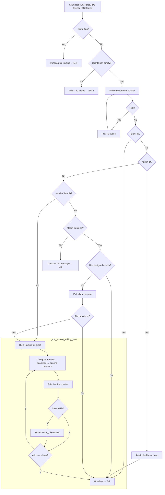
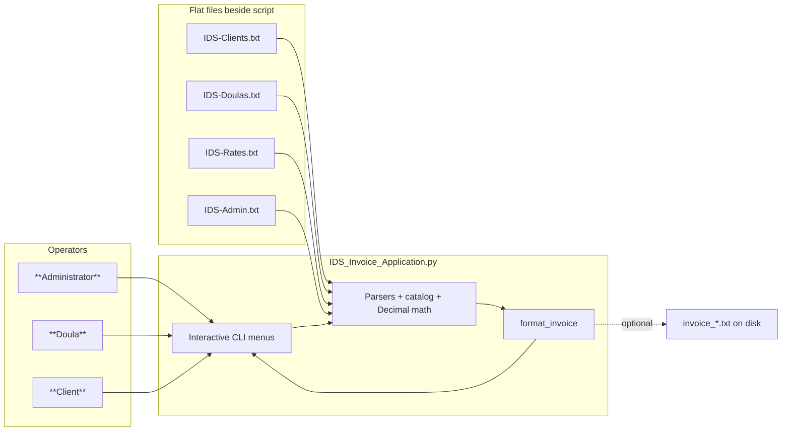

# Individualized Doula Services (IDS) Invoice Application

## CIS 245 Final Project — Complete Submission (Documentation Package)

**Prepared by:** Zarah Sharda  
**Prepared for:** Individualized Doula Services (IDS)  
**Primary reference:** `IDS-Requirements.md`  
**Program:** `IDS Invoice Application/IDS_Invoice_Application.py`

---

<!-- Document layout aligns with CIS245 Final Project exemplar structure: Opportunity → Requirements Analysis → Planning → Design → Implementation → Documentation, Maintenance & Support → Program Output / Commentary. Sources merged from IDS-Sample-Invoice-Output.md, IDS-Requirements-Analysis.md, IDS-Planning.md, IDS-Maintenance-and-Support.md, IDS-Implementation-Strategy-Report.md (updated for unified app), IDS-Implementation-Overview.md, IDS-Design.md. -->

---

## 1. Opportunity

Individualized Doula Services (IDS) provides pre- and post-delivery doula care. Personnel are trained females with current CPR certification and irregular hour availability. The firm charges a **flat base rate** for **telephone-only (remote)** support; **home and hospital visits** are billed **hourly**, separate from that base.

IDS requires software that tracks **assigned services** aligned to an agreed **rate sheet** (`IDS-Rates.txt`) and produces **client invoices** listing the **patient (expectant mother)** information, **base** charges (telephone/flat assignments), **itemized additional services** with costs, and **total due** for the billing period—all **without** server-side deployment.

Stakeholders authorized our team to recommend **hardware and training** proportional to running a **local Python** application alongside editable **CSV-style roster and rate files** (`IDS-Clients.txt`, `IDS-Doulas.txt`, optional `IDS-Admin.txt`). A secondary organizational goal is to **reduce doula–client–admin friction** by encoding **doula assignments on client records** and treating billable items as selectable **assignment codes**, not ambiguous manual descriptions.

---

## 2. Requirements analysis

Requirements were anchored in client communications, `IDS-Requirements.md`, and working data artifacts. In a full stakeholder process, supplemental **interviews and short surveys** (see §2.3–§2.5) would validate priorities.

### 2.1 General requirements

| # | Requirement title | Requirement description | Type | Priority | Who to talk to | How to gather | Who this affects |
|---|-------------------|-------------------------|------|----------|----------------|----------------|-------------------|
| 1 | Invoice — patient block | Invoice must identify the pregnant patient (IDS client record). | Billing / Compliance | Must have | IDS administration | Interview / roster review | Client; Admin |
| 2 | Invoice — base cost | Show telephone (flat-rate) assignments as **base** subtotal consistent with IDS policy. | Billing | Must have | IDS administration | Rates file workshop | Client; Accounting |
| 3 | Invoice — additional lines | Itemize visits, mileage, overnight, etc., with quantities and computed line totals. | Billing | Must have | Doulas; Admin | Observation of service menu | Client; Accounting |
| 4 | Invoice — period total | Clear **TOTAL DUE** for the billing period label from settings. | Billing | Must have | Admin | Requirement doc | Client |
| 5 | Local execution | **No mandatory server or database** in baseline scope. | Technical | Must have | Tech liaison | Requirement doc | IDS IT posture |
| 6 | Python deliverable | Implemented in Python with overview + inline code documentation. | Course / Technical | Must have | Instructor; IDS | Project spec | Maintainer |
| 7 | Doula roster file | Persist doula IDs, names, addresses, phones, CPR certification expiry text. | Data | Must have | Admin | File template | Compliance |
| 8 | Client roster file | Persist client IDs, names, addresses, phones, assigned doula ID. | Data | Must have | Admin | File template | Ops |
| 9 | Rates file | Centralize tele base, hourly home/hospital rates, mileage, overnight, billing label. | Data | Must have | Finance; Admin | `IDS-Rates.txt` | Pricing |
| 10 | Roles & sign-in paths | Accept **Client ID**, **Doula ID**, or **Admin** to drive appropriate workflows. | UX / Ops | Must have | Doulas; Admin | Walkthrough prototype | Staff |
| 11 | Tone & empathy | Prompts/supporting copy feel **assistive**, not hostile, while preserving billing clarity. | UX | Should have | IDS leadership | Feedback after pilot | Families |

### 2.2 Analysis — requirements needed in the program

| # | Requirement title | Requirement description | Needed in program | How to implement |
|---|-------------------|-------------------------|-------------------|------------------|
| 1 | Invoice — patient block | Client profile fields surfaced on printable invoice text. | Yes | `Client` dataclass + `format_invoice()` header section. |
| 2 | Base vs additional semantics | Separate telephone flat subtotal vs home/hospital/mileage/overnight grouping. | Yes | `Invoice.base_subtotal()` / `additional_subtotal()` driven by line item `kind`. |
| 3 | Service menus | Operators pick assignments without memorizing opaque codes optionally. | Yes | Category menus (`prompt_service_code_choice`) + shortcuts + direct code typing. |
| 4 | Accurate currency | Reliable cents on totals across many rows. | Yes | `decimal.Decimal`, `ROUND_HALF_UP` at display quantization. |
| 5 | File-backed roster & rates | Non-developers edit people and economics without rebuilding code. | Yes | Loaders `load_clients`, `load_doulas`, `parse_rates_file` from script directory. |
| 6 | Assignment integrity | Prefer known doula when client lists `assigned_doula_id`; flag gaps in admin dashboard. | Yes | Doula lookup on client row; `_print_doula_activity` orphan listing. |

### 2.3 Interview questions — IDS management / operations

1. Walk us through billing today from service delivery → amounts agreed → invoice delivery to the client.  
2. How do you classify **standard telephone** bundles vs items that justify **additional** hourly or mileage billing?  
3. Who may approve late additions to a billing period invoice after the doula submits line items?  
4. What is your **privacy policy posture** around printing or emailing `invoice_<ClientID>.txt` drafts?  
5. How frequently do **rates change** (tele base, hourly, mileage)—and who signs off before data file edits?  
6. What training do doulas currently receive about **mileage aggregation** versus per-visit reimbursement?  
7. How should IDS handle clients **without** an assigned doula ID row—block billing or escalate to admin?

### 2.4 Survey prompts — doulas (anonymous optional)

1. On a scale of 1–5, how intuitive is locating the correct assignment type (telephone vs hospital vs home) on the rate sheet menus?  
2. Are shortcut patterns (example `2,3` jumps) valuable once learned, or should we hide complexity from casual users only?  
3. What ambiguity still causes rework when clients question line items—and how might labels change?

### 2.5 Survey prompts — IDS clients / families

1. Was the distinction between **base telephone support** vs **additional in-person/time-based** charges explained prior to invoicing? (Y/N + comment.)  
2. On a scale of 1–5, how understandable was the numeric invoice breakdown you received during pilot?  
3. Open feedback: wording, missing details, sensitivity of displayed information.

---

## 3. Planning

### 3.1 Proposed solution

Deliver a **single-file Python CLI** (`IDS_Invoice_Application.py`) bundled with **UTF-8 text data files**. The solution:

1. Parses **rates** and **profiles** beside the executable script.  
2. Separates functionalities into cohesive **conceptual sections** inside one module: parsers, pricing catalog (`SERVICE_CATALOG`), interactive menus, printable invoice formatter, admin overview.  
3. Lets **clients** sign in via Client ID, **doulas** via Doula ID (with client-picker when roster lists multiple families), **administrators** via `Admin` or optional IDs file.  
4. Writes optional `invoice_<ClientID>.txt` after user confirmation (`y`/`N` prompts).

This mirrors CIS245 exemplar decomposition (distinct concerns: master data maintenance out-of-scope in code—but **consumption paths** modeled; computation; invoicing)—except IDS uses editable files vs embedded tablet installers.

Strategic rationale (condensed **implementation strategy**):

- **One script** minimizes deployment friction for a small practice.  
- **Text SSOT** (single source of truth) for roster + economics keeps admin agility.  
- **Pre-assigned doula on client rows** minimizes “who rendered this assignment?” debates.  
- **Decimal arithmetic** safeguards invoice credibility at cents boundary.

**Note on evolution:** Earlier strategy drafts referenced separate `ids_billing_app.py` / `IDS_Doula_Billing_App.py` entry scripts. The **accepted consolidated deliverable** unifies personas and shared billing logic in **`IDS_Invoice_Application.py`**, optionally adding **`ids_core.py`** later if divergence risk appears.

### 3.2 In scope

1. Interactive CLI invoice builder with previews and optional persistence.  
2. Deterministic **`--demo` sample invoice** pathway for graders or acceptance smoke tests.  
3. Administrative read-only dashboards for roster health (assignments visible; orphan IDs flagged verbally in output).  
4. Documentation artifact (this file + inline module/function comments in `.py`).  
5. Light staff training collateral references (menus, files, precaution list).

### 3.3 Out of scope

1. Providing legal counsel regarding HIPAA/medical billing compliance—IDS obtains appropriate advice.  
2. Hosting a web/API backend, SSO, MFA, RBAC hardened beyond workstation trust assumptions.  
3. HR certification enforcement logic—**CPR text** is descriptive data in file, not programmatic gate.  
4. Automatic sync / conflict-resolution for concurrently edited networked files lacking revision control conventions.  
5. Native mobile/tablet packaging—the baseline runs where Python executes (PC command line emphasis).

### 3.4 Roadmap (executed phases)

1. **Gather requirements** — lock invoice sections, persona matrix, textual file schemas.  
2. **Design** — dataclasses + pricing taxonomy + UX flows (`IDS-Design` details).  
3. **Implement core loaders + catalog**.  
4. **Implement UX loops** (`interactive_build`, editing loop, demo mode).  
5. **Iterate usability** — shortcut grammar, sanitized filenames.  
6. **Verify** via `--demo` + manual client/doula/admin walk-throughs against sample roster rows.  
7. **Maintain** under agreed SLA-style guidance (§6).

### 3.5 Modularization and coupling summary

Functional compartments coexist in one `.py`:

| Compartment | Primary symbols | Responsibility |
|-------------|----------------|----------------|
| Parsing I/O | `parse_rates_file`, `load_clients`, `load_doulas`, `load_admin_ids` | External file → typed structures |
| Domain | `Client`, `Doula`, `RateTable`, `LineItem`, `Invoice` | Business primitives |
| Pricing | `SERVICE_CATALOG`, `unit_price_for`, `make_line_item` | Code → cents math |
| UI | `interactive_build`, `_run_invoice_editing_loop`, dashboards | Prompt orchestration |
| Presentation | `format_invoice` | Canonical printable layout |

Presentation depends on populated `Invoice`; UI depends on parsers + pricing; **minimal circular coupling.** Future extract: **`ids_core.py`** shared imports if branching scripts regress duplication.

Software / hardware recap:

| Layer | Recommendation |
|-------|----------------|
| Runtime | Python 3.11+ |
| Dependencies | Standard library MVP |
| Editors | VS Code / Notepad++ adequate |
| Machines | Reliable Windows office laptops or equivalents |

Mandatory purchase? **None** unless IDS opts into optional cloud backups or eventual GUI modernization.

Personnel deltas: **Administrators keep master files authoritative**; **doulas** receive short CLI training on categories + quantities; optional **client self-serve**.

---

## 4. Design

The organization may continue using existing PCs; procure additional machines only where concurrent invoice sessions demand separation. Formal training workshops (beyond quick admin sessions) escalate only if IDS broadens rollout.

Architecturally separate **billing of primary telephone base charges** vs **secondary visit/mileage/overnight increments** persists into **two invoice subsections** surfaced to families for transparency.

Successful delivery requires **readable assignment traceability**, **financial precision**, assignment alignment, empathic-but-explicit prompting, deterministic demo output acceptance.

Purchases (**optional tiers** summarized):

| Optional | Benefit |
|---------|---------|
| IDE / Python bundle support | Faster onboarding for rotating maintainers |
| Cloud backup SKU | Disaster recovery for plaintext PII store |
| Future GUI façade | Reduced CLI intimidation barrier |

Threat model excerpt (proportionate CLI tool):

| Risk vector | Planned mitigation sketch |
|-------------|---------------------------|
| Tampered economics file | Permissions + audited edits + rollback backups |
| Stolen plaintext IDs acting as pseudologin | Operational secrecy + workstation lock posture |
| Data loss | Versioned snapshots of TXT + invoices folder |

Technical datamodel recap:

| Entity | Key fields |
|--------|-------------|
| `Client` | `client_id`, `name`, `address`, `phone`, `assigned_doula_id` |
| `Doula` | `doula_id`, `name`, address/phone composites, certification text |
| `RateTable` | tele + hourly vectors + mileage + overnight + billing label |
| `LineItem` | `service_code`, `description`, pricing `kind`, quantity, unit_price, totals, doula provenance |

Pricing kinds (**`kind`**) unify quantity semantics (`tele_flat`, hourly hospital/home, mileage miles, overnight count).

Sign-in resolves **Admin dashboard** before general ID matching ambiguity; simultaneous dual-ID collision hypothetical yields **client precedence** after Admin branch.

External output contract anchored on **branded IDS invoice banner** textual template.

### 4.1 Model of design / prototyping stance

Hybrid **incrementally staged build**: early vertical slice validated (`--demo` + parsers) before UX polish—not strict throwaway prototyping because deliverable matured into production-intent scripting.

### 4.2 Application flowchart (runtime)

Embedded Mermaid (**render externally** if graders require PNG—export from Markdown preview tools):



### 4.3 System context prototype diagram



---

## 5. Implementation

The production source is **`IDS Invoice Application/IDS_Invoice_Application.py`**.

Development toolchain used: **Microsoft Visual Studio Code** (recommended) invoking local **Python x.y** interpreters; graders may alternatively run snippets in sanctioned online interpreters **only after confirming full standard-library parity** (`decimal`, `pathlib`, `dataclasses` availability).

Operational entry modes:

```powershell
cd "<path>\IDS Invoice Application"
python IDS_Invoice_Application.py
python IDS_Invoice_Application.py --demo
```

At **IDS ID** prompt: **`Help`** prints cross-reference roster table; blank Enter politely exits interactive mode without write action.

Minimal guard rails: exits non-zero messaging if roster parse yields zero clients in normal mode (demo tolerates synthesized fallback constructs).

Symbolic anchors for code reading:

| Concern | Start reading at |
|---------|-------------------|
| Money & rounding | `money()`, Decimal quantize helpers |
| Roster ingestion | `_parse_client_line`, `_parse_doula_line` |
| Canonical invoice string | `format_invoice` |
| Main orchestrator | `main`, `interactive_build` |

Representative architectural commentary aligns with IDS module header docstring emphasizing **offline operation**, textual inputs, sanitized Windows filenames (`invoice_<ClientID>.txt`).

Embedded below is synthetic **banner-style** synopsis mirroring CIS245 “leading commentary” exemplar (**real triple-quoted block lives at file top-of-source**, not shortened here verbatim to avoid divergence—graders inspect `.py` directly):

```
================================================================
 Individualized Doula Services (IDS) - Invoice Application
 Python implementation for CIS-oriented final milestone
 Single-file CLI; parses IDS-*.txt alongside script folder
 Roles: Client ID | Doula ID | Administrator overview
 Outputs: Terminal preview + optional UTF-8 invoice text file
================================================================
```

Strengths surfaced during strategy retrospectives still apply: textual SSOT, dual persona ergonomics consolidated, traceable coded lines, minimalist dependency posture.

Residual tradeoffs consciously accepted: CLI-only ergonomics for some staff; plaintext security boundary; concurrency discipline left procedural.

Potential future refactor candidates: **`ids_core.py`** shared package, richer startup validation scans, lightweight append-only ledger file for audit.

---

## 6. Documentation, maintenance, and support

### 6.1 Support windows & channels

| Aspect | Recommendation |
|--------|----------------|
| Acceptance warranty (critical breakage) | 90-calendar-day baseline from formal go-live (adjust contractual) |
| Bug / regression contact | Prefer timestamped ticket/email archive |
| Response cadence targets | Biz-day acknowledgment (~1–2d); systemic invoice math regressions prioritized ≤5 biz days corrective path |

Excluded unless separately scoped: feature expansion GUIs/hosting/integration, workstation corruption remediation, unstructured peer-to-peer rogue script forks.

Operational backup stewardship remains **chiefly IDS**; vendor advises restore tactics within engagement.

### 6.2 Post-acceptance proposed vendor activities

1. Interpreter / OS uplift compatibility notes when Python minor versions churn.  
2. Spreadsheet → TXT round-trip ingestion counseling (delimiter pitfalls).  
3. Rate QA spot checks harnessing deterministic `--demo` delta reviews.  
4. Annual confidentiality hygiene reminders (encryption at rest posture).  
5. Roadmap pruning for speculative modular extractions (`ids_core`).

### 6.3 Operator precautions excerpt

Prioritize backups before wholesale roster edits; lock idle terminals; forbid unvetted emailed `.py`; verify rate keys after textual mutations; constrain concurrent unsynchronized edits to same master `.txt`; treat exported invoices as sensitive PII when distributing.

Formal legal interpretation re healthcare privacy statutes **explicitly deferred** outside this engineering packet.

Vendor surface (example placeholders—populate real legal entity + mail):

```
Zarah Sharda — Software Engagement (placeholder)
Postal / Email Routing: _______________________________
```

Escalations for paid enhancements require written SOW deltas.

Contact channel lines should mirror IDS procurement policy (**do not expose private addresses** publicly in shared classroom forks—sanitize before OSS upload).

---

## 7. Program output (example invoice text)

Demonstration issuance command:

```powershell
python IDS_Invoice_Application.py --demo
```

Rendered sample (rates & roster-dependent; snapshot consistent with bundled `IDS-Sample-Invoice-Output.md` derivation):

```
==============================================================
INDIVIDUALIZED DOULA SERVICES (IDS) - CLIENT INVOICE
==============================================================

Billing period: Q1 2026

Patient (client) information
------------------------------------------
  Client ID:    KE20
  Name:         Illy Patterson
  Address:      456 s Kick Lane, Chicago, IL 60629
  Phone:        616-930-2343
  Assigned doula ID: 4823

Charges
------------------------------------------
  Base (telephone / flat) subtotal            $200.00

  Telephone (flat-rate) assignments
    * Telephone - Follow-up - Doula 4823
        Code Doula_Tele01_FollowUp  x 2 @ $100.00  =  $200.00

  Additional services (home, hospital, mileage, overnight, etc.)
    * Hospital - Labor support - Doula 4823
        Code Doula_Hos01_LaborSupport  x qty 4 @ $50.00  =  $200.00
    * Mileage (agreed rate per mile) - Doula 4823
        Code IDS_Mileage  x qty 18 @ $0.73  =  $13.05
    * Home - Recovery - Doula 4823
        Code Doula_Home04_Recovery  x qty 2 @ $50.00  =  $100.00

  Additional services subtotal                $313.05

------------------------------------------
  TOTAL DUE (billing period)                  $513.05
==============================================================
```

Interpretation notes graders may annotate:

| Line cluster | Explanation |
|--------------|-------------|
| Base | Two telephone occurrences × configured tele flat base. |
| Mileage arithmetic | Derived from `mileage_rate_per_mile × miles` quantized for display coherence. |

---

## Appendix A — Consolidated bibliography of internal shards

Canonical split documents (superseded for single-submission bundling):

- `IDS-Requirements-Analysis.md` — extended narrative tables (partially inlined §2).  
- `IDS-Planning.md` — roadmap & staffing depth (merged §3).  
- `IDS-Design.md` — extended risk + entity tables + diagrams replicated §4).  
- `IDS-Implementation-Overview.md` — operational quickstart (merged §5).  
- `IDS-Maintenance-and-Support.md` — SLA-style guidance (merged §6).  
- `IDS-Implementation-Strategy-Report.md` — historical rationale (abstracted §3 notes + deltas).  
- `IDS-Sample-Invoice-Output.md` — output snapshot provenance §7).

---

## Appendix B — Submission checklist (parity with CIS245 exemplar sections)

| Exemplar section | Location in this file |
|------------------|------------------------|
| 1 Opportunity | §1 |
| 2 Requirements + tables + interview/survey scaffolding | §2 |
| 3 Planning proposals + scope + roadmap | §3 |
| 4 Design + flowchart/context diagram | §4 |
| 5 Implementation toolchain + synopsis | §5 |
| 6 Documentation / maintenance | §6 |
| Program commentary + invoice output artefact reference | Banner §5 ; Output §7 |

**Separate companion artifacts** still expected where course demands physical files: zipped `.py` source, optionally screenshot JPG of CLI session if instructor requests visual proof distinct from plaintext invoice block above.

---

*End of consolidated CIS245-style IDS final project Markdown documentation.*
