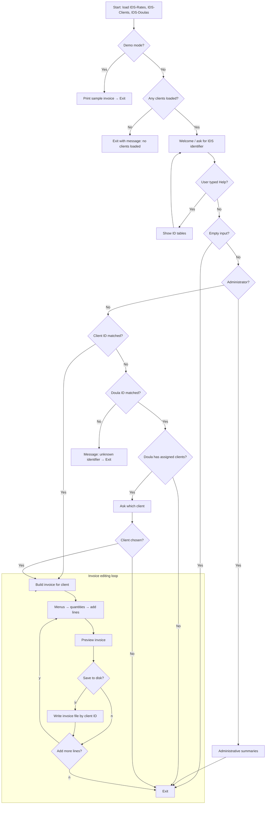
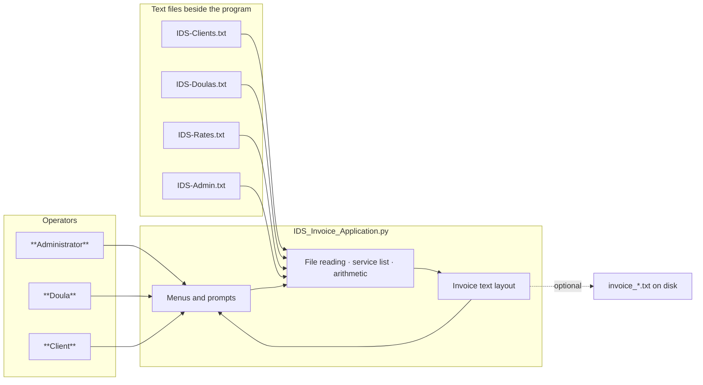

# Individualized Doula Services (IDS) Invoice Application

## CIS 245 Final Project — Documentation Package

**Prepared by:** Charletta S. Hudson  
**Prepared for:** Individualized Doula Services (IDS)  
**Requirements reference:** `IDS-Requirements.md`  
**Application:** `IDS_Invoice_Application.py`

---

## 1. Opportunity

Individualized Doula Services (IDS) provides prenatal and postpartum doula care. Personnel are certified, maintain current CPR training, and accommodate irregular schedules. Billing policy distinguishes telephone-only services, charged at a flat agreed rate, from home and hospital visits, which are billed by the hour in addition to the telephone base layer.

IDS needs a reliable application that aligns billable activity with its published fee schedule (document `IDS-Rates.txt`) and produces client-ready invoices. Each invoice should include the patient’s identifying information (the expectant mother as IDS's client), base charges attributable to telephone or flat-priced assignments, itemized additional services with amounts, and a total due for the stated billing period. The application is able to run on local computers without requiring IDS to operate a dedicated internet-facing server for this purpose.

IDS has authorized recommendations for hardware and training** proportionate to running a Python program on office equipment, with editable text-based lists for clients, doulas, and rates (`IDS-Clients.txt`, `IDS-Doulas.txt`, and optional `IDS-Admin.txt` for extra administrator sign-ins). A related goal is to reduce disputes and administrative burden by recording each client’s assigned doula in the client list and by charging only through standard service codes drawn from the firm’s menu, rather than free-text descriptions that invite inconsistency.

---

## 2. Requirements analysis

Requirements draw on direct project documentation (`IDS-Requirements.md`), working data files, and client discussions. 

### 2.1 General requirements


| #   | Requirement                       | Description                                                                                                            | Category                | Priority     | Primary contacts        | How to confirm                          | Affected parties   |
| --- | --------------------------------- | ---------------------------------------------------------------------------------------------------------------------- | ----------------------- | ------------ | ----------------------- | --------------------------------------- | ------------------ |
| 1   | Patient identification on invoice | Invoice clearly identifies the pregnant patient per IDS client record.                                                 | Billing / IL Compliance | Required     | IDS Admin               | Interview; roster review                | Client; IDS Admin  |
| 2   | Base charges                      | Telephone (flat-rate) assignments appear as a **base** subtotal per IDS policy.                                        | Billing                 | Required     | IDS Admin               | Review of rate file and sample invoices | Client; IDS Admin  |
| 3   | Itemized additional services      | Visits, mileage, overnight stays, and similar items listed with quantities and dollar amounts.                         | Billing                 | Required     | Doulas; IDS Admin       | Observation against service menu        | Client; IDS Admin  |
| 4   | Period total                      | **Total due** is explicit for the billing period named in configuration.                                               | Billing                 | Required     | IDS Admin               | Requirements review                     | Client             |
| 5   | Local operation                   | Baseline scope does **not** require a shared company database server or mandatory hosted backend.                      | Technical               | Requirements | Software Developer      | Written requirement                     | IDS Admin          |
| 6   | Python delivery                   | Implemented in Python, with narrative overview and explanatory comments embedded in source code.                       | Technical               | Requirements | Software Developer      | IDS Specification                       | Software Developer |
| 7   | Doula roster file                 | Stores doula identifiers, names, addresses, telephone numbers, and CPR certification wording.                          | Data                    | Required     | IDS Admin               | Approved file layout                    | IDS Admin          |
| 8   | Client roster file                | Stores client identifiers, names, addresses, telephones, and assigned doula identifier.                                | Data                    | Required     | IDS Admin               | Approved file layout                    | IDS Admin          |
| 9   | Rates file                        | Single place for telephone base rate, hourly home and hospital rates, mileage, overnight charge, billing period label. | Data                    | Required     | Finance; administration | Reference file `IDS-Rates.txt`          | IDS Admin          |
| 10  | Role-based entry                  | Recognizes **Client ID**, **Doula ID**, or **Administrator** and opens the matching experience.                        | Operations              | Required     | Doulas; administration  | Guided walkthrough                      | IDS Staff          |
| 11  | Supportive tone                   | On-screen wording is courteous and instructional while remaining precise for billing.                                  | Experience design       | Desired      | IDS leadership          | Pilot feedback                          | All                |


### 2.2 Analysis — inclusion in software and supporting design


| #   | Requirement                    | In plain language                                                                                                                 | Included | Realization                                                                                                                                         |
| --- | ------------------------------ | --------------------------------------------------------------------------------------------------------------------------------- | -------- | --------------------------------------------------------------------------------------------------------------------------------------------------- |
| 1   | Patient block                  | Patient details appear on the printed-style invoice layout.                                                                       | Yes      | Structured client record and dedicated invoice header formatting (types and functions centered on `**Client`** and `**format_invoice`** in source). |
| 2   | Base versus additional charges | Telephone flat items summarize under **base**; visits and similar items group under **additional services**.                      | Yes      | Invoice subtotals derive from **line item type**, via methods `**base_subtotal`** and `**additional_subtotal`**.                                    |
| 3   | Service selection              | Staff choose services via menus rather than relying solely on memorized internal codes (codes still permitted for trained users). | Yes      | Guided category prompts, keyboard shortcuts where helpful, optional direct code entry.                                                              |
| 4   | Accurate amounts               | Dollars and cents remain consistent across many lines.                                                                            | Yes      | Money handled with `**decimal.Decimal`** and consistent rounding rules for display.                                                                 |
| 5   | Editable master data           | Administrators update people and rates in text files without modifying program code each time.                                    | Yes      | Dedicated routines load clients, doulas, and rates from files next to the program.                                                                  |
| 6   | Assignment consistency         | Prefer showing a known doula when the client row lists one; alert when identifiers do not line up across files.                   | Yes      | Lookup from client roster to doula roster; administrator summary surfaces gaps.                                                                     |


### 2.3 Interview Questions — IDS Firm

1. Describe today’s billing path from delivery of services through agreement on amounts through delivery of the invoice to the client.
2. How does IDS classify work that belongs under standard telephone bundles versus charges that qualify as hourly, mileage-based, or other add-ons?
3. Who is authorized to approve late changes to an invoice once a doula has entered line items?
4. What policy governs printing, emailing, or archiving draft invoices saved as `invoice_<ClientID>.txt`?
5. How often do rates change, and who must approve updates to the rates file before they take effect?
6. How are doulas trained on recording mileage and travel time so billing stays uniform?
7. If a client record lacks an assigned doula identifier, should the system block invoicing or route the case to an administrator?

### 2.4 Survey Questions — Doulas

1. On a scale of 1 to 5, how easy is it to find the right category (telephone, hospital, home) in the on-screen menus?
2. After training, do combined keystroke shortcuts (such as `2,3`) meaningfully reduce effort, or should casual users stay on numbered menus alone?
3. When families question charges, what labeling or wording still creates confusion—and what would clarify it?

### 2.5 Survey Questions — Clients and Families

1. Were you informed, before invoicing, how **telephone package charges** differ from **in-person or time-based** charges? Answer yes or no with comment.
2. On a scale of 1 to 5, how clear was the dollar breakdown during any pilot invoicing period?
3. Open-ended comments about tone, completeness, or sensitivity of personal information displayed.

---

## 3. Planning

### 3.1 Proposed solution

Deliver `IDS_Invoice_Application.py`, one Python module, packaged with companion **plain-text master files** encoded in UTF-8 (standard international text format). Upon launch it:

1. Reads **rates and roster information** from files stored alongside the program.
2. Organizes internal logic into coherent areas inside that single module: loading files, translating services to prices and labels, conversational menus, printable invoice wording, administrator summaries.
3. Accepts entry as a **client** (by Client ID), **doula** (by Doula ID, with selection among assigned clients where several apply), or **administrator** (including optional IDs listed beside the program in `IDS-Admin.txt`; the word **Admin** always works).
4. After preview, optionally saves `invoice_<ClientID>.txt` only when the user confirms.

This allows IDS to retain **spreadsheet-export–friendly text lists** instead of pre-installed tablet storefronts.

**Developer Thought Process**

- A **single shipped module** lowers installation steps for a small practice.  
- **One authoritative set of text lists** carries roster and economics; administrators revise those files directly.  
- **Doula assignment stored on each client row** aligns billing attribution with operational assignment and reduces disagreement about responsibility for each line item.  
- **Decimal-based arithmetic** avoids penny drift that can undermine trust.

**Developer note.** Early internal drafts were separate Python entry scripts for clients and doulas. The current **delivered product unifies both roles** (and administration) in `IDS_Invoice_Application.py`. 

### 3.2 In scope

1. Terminal-based invoice building with on-screen preview and optional file save.
2. A **demonstration mode** (`--demo`) that prints a predictable sample invoice for grading or acceptance checks.
3. Administrator views that **list assignments** and call attention when a client’s doula identifier does not match any doula profile.
4. External documentation (this package) and internal comments in the `.py` file.
5. Brief staff orientation material covering menus, file locations, and safe operating practices.

### 3.3 Out of scope

1. **Legal advice** on health privacy or billing regulations; IDS retains qualified counsel.
2. **Enterprise web login** (single sign-on, multi-factor authentication, granular web permissions) beyond trusting the office workstation for access control.
3. **Automatic enforcement of HR rules** from CPR text in files; the file holds informational wording, not an automated compliance gate.
4. **Automatic merging** of conflicting edits when two people change the same master text file through cloud sync without coordination.
5. **Packaged mobile or tablet application**; the baseline assumes Python on a desktop or laptop with a terminal window.

### 3.4 Roadmap (completed stages)

1. Confirm invoice layout, user roles, and text file formats.
2. Complete technical design: data structures, pricing categories, user flows (see Design section).
3. Implement file loading and the master service list with prices.
4. Implement interactive sessions, editing loop, and demonstration mode.
5. Refine usability (shortcuts, safe file names on Windows).
6. Verify with demonstration output and walkthroughs for client, doula, and administrator paths.
7. Transfer to operations under the support expectations in Section 6.

### 3.5 How the program is organized internally

All areas below live in one `.py` file but address distinct responsibilities:


| Area              | Representative parts of the source                                                       | Purpose                                                    |
| ----------------- | ---------------------------------------------------------------------------------------- | ---------------------------------------------------------- |
| Reading files     | Routines that open `IDS-Rates.txt`, `IDS-Clients.txt`, `IDS-Doulas.txt`, `IDS-Admin.txt` | Turn text rows into structured records the program can use |
| Core records      | Definitions for client, doula, rate table, invoice line, full invoice                    | Hold business information in a consistent shape            |
| Pricing           | Catalog of service codes, unit price lookup, building a line item                        | Convert chosen services into dollars                       |
| Conversation flow | Main sign-in, line-item editing loop, administrator menus                                | Guide the operator through prompts                         |
| Invoice layout    | Function that renders the readable invoice block                                         | Produce identical text whether shown on screen or saved    |


Higher-level layout depends only on assembled invoice contents; dependence runs in one direction rather than looping back unnecessarily. If IDS later splits code across files, a new file called `ids_core.py` could centralize loading and arithmetic while thin front ends handle sign-in—but that is optional.

### Software and equipment summary


| Layer            | Recommendation                                                         |
| ---------------- | ---------------------------------------------------------------------- |
| Language runtime | Recent Python (3.11 or newer suggested)                                |
| Add-on libraries | None required; standard installation is sufficient                     |
| Editing tools    | Visual Studio Code, Notepad++, or equivalent                           |
| Hardware         | Reliable office desktops or laptops (Windows-compatible paths assumed) |


**Mandatory new purchases:** none, unless IDS elects optional paid backup tools or eventually funds a graphical interface.

### Staff impact

- **Administrators** remain custodians of master text files and rate settings.  
- **Doulas** receive concise training on navigating categories and entering hours, miles, or counts.  
- **Clients** may use the application directly with Client ID entry if IDS chooses that workflow.

---

## 4. Design

Invoice layout intentionally splits **telephone base charges** from **additional services** (visits, mileage, overnight arrangements) so families see a transparent structure.

### Optional purchases


| Option                                    | Benefit                                                           |
| ----------------------------------------- | ----------------------------------------------------------------- |
| Professional Python tooling subscriptions | Faster staff turnover for anyone maintaining code                 |
| Cloud or managed backup                   | Recovery if hardware fails; protects client and fiscal text files |
| Future graphical interface                | Easier for staff uneasy with a terminal window                    |


### Risk awareness (appropriate to a local office tool)


| Concern                                                            | Direction for mitigation                                          |
| ------------------------------------------------------------------ | ----------------------------------------------------------------- |
| Unauthorized edits to the rates file                               | Restrict file permissions, document approvers, keep dated backups |
| Casual use of Client or Doula IDs as if they were strong passwords | Treat identifiers as sensitive; lock workstations; train staff    |
| Loss of data                                                       | Regular backup copies of master lists and saved invoices          |


### Information the program tracks (conceptual)


| Record          | What it holds                                                                                        |
| --------------- | ---------------------------------------------------------------------------------------------------- |
| Client          | Identifier, name, address, telephone, assigned doula identifier                                      |
| Doula           | Identifier, name, address, telephone, certification wording                                          |
| Rate table      | Telephone base, hourly rates, mileage rate, overnight rate, billing period label                     |
| Line on invoice | Service code, description, charge type, quantity, unit price, line total, doula reference when known |


**Charge types** distinguish flat telephone items, hourly hospital work, hourly home work, mileage by mile, and flat overnight units. Sign-in logic checks for **administrator** first; in the rare case of identifier overlap between a client and doula, **client** takes precedence after that check. Final output uses a consistent **IDS invoice header** so every document is immediately recognizable.

### 4.1 Design approach

Development proceeded in stages: a working core (read files, print demonstration invoice) before polish on menus and messaging. The result is production-oriented script.

### 4.2 Application flow

The diagram below reflects the flow of the program.




### 4.3 Context diagram — people, files, and program




---

## 5. Implementation

**Source location:** `IDS Invoice Application/IDS_Invoice_Application.py`

Developer used **Microsoft Visual Studio Code** with a locally installed Python interpreter to run program. Program was also successfully ran online using [Online Python - IDE, Editor, Compiler, Interpreter](https://www.online-python.com/) 

```markdown
https://www.online-python.com
```

**Typical commands** (adjust the folder path):

```powershell
cd "<path>\IDS Invoice Application"
python IDS_Invoice_Application.py
python IDS_Invoice_Application.py --demo
```

During normal use, `Help` at the identifier prompt prints a reference table of clients and doulas. Leaving the identifier blank exits politely without saving.

The program terminates with an explicit error indication if normal mode loads **no clients**—a safeguard against empty or malformed client files—while demonstration mode can still synthesize a minimal illustration when needed.

### Where to start reading source code


| Topic                                    | Approximate anchor in code                   |
| ---------------------------------------- | -------------------------------------------- |
| Currency display and rounding            | `money` and decimal handling nearby          |
| Building client and doula rows from text | Parsing helpers named for clients and doulas |
| Invoice wording                          | `format_invoice`                             |
| Startup and conversations                | `main`**,** `interactive_build`              |


The module’s opening commentary states that the program runs **offline**, reads **local text files**, produces **safe Windows file names** for saved invoices, and supports **client, doula, and administrator** entry.

**Summary banner (reflects source intent; exact wording appears at top of `.py` file)**

```
================================================================
 Individualized Doula Services (IDS) - Invoice Application
 CIS 245 project implementation
 Single program file; reads IDS-*.txt from the same folder
 Entry: Client ID | Doula ID | Administrator overview
 Output: screen preview and optional UTF-8 text invoice file
================================================================
```

**Strengths** carried forward from design review: single authoritative text-based data store, one program for all roles, every line tied to an official service code, no commercial library dependencies.

**Accepted limitations:** terminal interface may feel unfamiliar to some staff; security assumes a trusted office machine; concurrent editing of the same master file without coordination remains an operational risk.

**Possible later improvements:** extract shared logic into `ids_core.py`; add stronger startup checks (for example, every assigned doula exists in the doula list); optional append-only activity log for audit support.

---

## 6. Documentation, maintenance, and support

### 6.1 Support expectations


| Topic                     | Proposed baseline                                                                                                                                                                                             |
| ------------------------- | ------------------------------------------------------------------------------------------------------------------------------------------------------------------------------------------------------------- |
| Coverage after acceptance | Ninety calendar days from formal go-live for **serious defects** (program will not start, crashes during normal entry, or invoice math differs materially from agreed rules); exact terms subject to contract |
| How to report issues      | Dated email or ticket thread                                                                                                                                                                                  |
| Response targets          | Acknowledgment within roughly one to two business days for routine items; priority attention for invoice total errors, targeted toward resolution within about five business days                             |


**Outside standard support** unless separately funded: large new features, hosting or website integration, repair of damaged operating systems, use of unofficial modified copies of the program.

**Primary responsibility for routine backups** remains with **IDS**; the developer can advise on recovery steps within the engagement.

### 6.2 Suggested ongoing activities after handoff

1. Keep a journal on when Python or Windows versions change significantly.
2. Refer to instructions for exporting spreadsheets to comma-separated text without breaking columns.
3. Run periodic checks that rate changes still match expected demonstration output.
4. Schedule annual reminder about encrypting laptops and limiting physical access to invoice folders.
5. Plan Follow-Up meeting to discuss code split into multiple files,  richer validation or any suggested updates.

### 6.3 Operating precautions

Back up master lists before bulk edits; lock unattended screens; do not run Python files from unknown email attachments; re-check sample invoices after changing the rates file; avoid two people overwriting the same master list without discipline; treat saved invoices as personally identifiable information when sharing.

This document does **not** supplement legal interpretation of health privacy law.

**Developer contact**


| Field        | Value                                                         |
| ------------ | ------------------------------------------------------------- |
| Organization | Zarah Sharda Creative Agency                                  |
| Email        | [chudson78@student.ccc.edu](mailto:chudson78@student.ccc.edu) |


Paid enhancements require an updated written scope. Public repositories should omit private contact details.

---

## 7. Program output (example invoice)

**Demonstration command**

```powershell
python IDS_Invoice_Application.py --demo
```

**Sample output** (figures depend on current roster and rate files; this snapshot matches the project’s reference example)

```
==============================================================
INDIVIDUALIZED DOULA SERVICES (IDS) - CLIENT INVOICE
==============================================================

Billing period: Q1 2026

Patient (client) information
------------------------------------------
  Client ID:    KE20
  Name:         Illy Patterson
  Address:      456 s Kick Lane, Chicago, IL 60629
  Phone:        616-930-2343
  Assigned doula ID: 4823

Charges
------------------------------------------
  Base (telephone / flat) subtotal            $200.00

  Telephone (flat-rate) assignments
    * Telephone - Follow-up - Doula 4823
        Code Doula_Tele01_FollowUp  x 2 @ $100.00  =  $200.00

  Additional services (home, hospital, mileage, overnight, etc.)
    * Hospital - Labor support - Doula 4823
        Code Doula_Hos01_LaborSupport  x qty 4 @ $50.00  =  $200.00
    * Mileage (agreed rate per mile) - Doula 4823
        Code IDS_Mileage  x qty 18 @ $0.73  =  $13.05
    * Home - Recovery - Doula 4823
        Code Doula_Home04_Recovery  x qty 2 @ $50.00  =  $100.00

  Additional services subtotal                $313.05

------------------------------------------
  TOTAL DUE (billing period)                  $513.05
==============================================================
```

**Reading the example**


| Section      | Meaning                                                                                                                           |
| ------------ | --------------------------------------------------------------------------------------------------------------------------------- |
| Base         | Two telephone line items at the configured flat telephone rate in the rates file.                                                 |
| Mileage line | Miles multiplied by the agreed per-mile rate; screen may round the unit rate for display while cents reconcile on the line total. |


---

*End of IDS SDLC documentation package.*