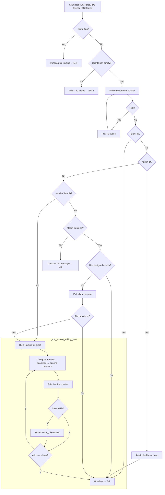
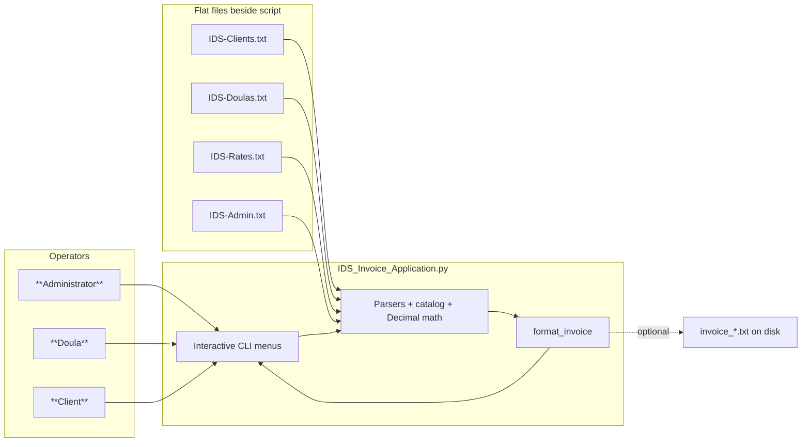

# IDS — Design Specification

**Prepared for:** Individualized Doula Services (IDS)  
**Prepared by:** Zarah Sharda  
**Implementations:** `IDS Invoice Application/IDS_Invoice_Application.py`  
**Reference:** IDS-Requirements.md

---

## 1. Purpose of this phase

Translate agreed requirements into **technical specifications**: data formats, behavioral rules, user flows, invoicing semantics, operational security, and **success criteria** so implementation and acceptance tests are unambiguous.

---

## 2. Purchases (equipment/software)

For the **baseline deliverable**, no mandatory purchases beyond existing office computers and Python are required.

**Optional upgrades** (if IDS outgrows the CLI):

| Optional item | Purpose |
|-----------------|---------|
| Commercial Python distribution / IDE | Streamline updates for staff who bundle scripts |
| Cloud backup subscription | Preserve `invoice_*.txt` and source data beyond one PC |
| Future GUI/web layer | Accessibility for non-terminal users—not in current scope |

---

## 3. Personnel and training

| Audience | Training need |
|-----------|----------------|
| **Data administrators** | File schema for clients/doulas/rates; never commit contradictory assigned doula IDs; backup cadence |
| **Doulas** | Sign-in with Doula ID; pick client when multiple assignments; navigate category menus and enter hours/miles |
| **Clients (optional)** | Sign-in with Client ID; recognize “base vs additional” invoice sections |

Training can be accomplished in **one short session** plus printed quick reference (`IDS-Implementation-Overview.md`).

---

## 4. Product success criteria

| Criterion | Design response |
|-----------|----------------|
| Invoice contents match IDS policy | Patient block + base tele subtotal + itemized additions + period total |
| Rate fidelity | `IDS-Rates.txt` drives decimals; catalog maps codes → pricing kind |
| Assignment integrity | Client row carries `assigned_doula_id`; line items annotate doula when resolved |
| Simplicity | No server; runnable from folder |
| Tone | Warm welcome/help text while staying accurate for billing |
| Acceptance aid | `--demo` reproduces deterministic sample output |

---

## 5. Security and data handling considerations

### 5.1 Threat model (proportionate)

The system assumes **trusted local workstations** and **plaintext source files**. It is **not** an online patient portal with authentication hardening.

| Risk | Mitigation in design |
|------|---------------------|
| **Tampering with rate files** | Restrict file permissions; keep dated backups on admin PC |
| **Invoice overwrites** | Filename `invoice_<ClientID>.txt`; users confirm save interactively |
| **Shoulder surfing / ID misuse** | Treat Client ID / Doula ID like shared secrets; educate staff (see Maintenance doc) |
| **Data loss** | Regular backup of `.txt` data and generated invoices |

### 5.2 Data classification

CSV-style files contain **PII** (names, phones, addresses) and operational notes (CPR expiry). Treat the application folder as **confidential** at the workstation and backup tier.

---

## 6. Technical specification

### 6.1 Data model (`dataclass` level)

| Entity | Fields |
|--------|--------|
| `Client` | `client_id`, `name`, `address`, `phone`, `assigned_doula_id` (optional but expected) |
| `Doula` | `doula_id`, `name`, `address`, `phone`, `certification_note` |
| `RateTable` | `tele_base`, `home_rate_per_hr`, `hospital_rate_per_hr`, `mileage_rate_per_mile`, `overnight_rate`, `billing_period_label` |
| `LineItem` | `service_code`, `description`, `kind`, `quantity`, `unit_price`, `line_total`, optional `doula_id`/`doula_name` |
| `Invoice` | `billing_period`, `client`, list of `LineItem`; methods `base_subtotal()`, `additional_subtotal()`, `total()` |

### 6.2 Pricing kinds (`kind`)

| Kind | Quantity meaning | Unit price source |
|------|------------------|-------------------|
| `tele_flat` | Count of telephone assignments × flat base each | `tele_base` |
| `hourly_hospital` | Hours | `hospital_rate_per_hr` |
| `hourly_home` | Hours | `home_rate_per_hr` |
| `mileage` | Miles | `mileage_rate_per_mile` (normalized from cents/dollar in file parser) |
| `overnight` | Count/units × overnight rate | `overnight_rate` |

All totals use **`Decimal`** with half-up quantization to cents.

### 6.3 Service catalog

Internal constant `SERVICE_CATALOG` aligns every billable **code** to a **kind** and **display label**. Codes mirror the menus documented in `IDS-Rates.txt` (Telephone, Hospital, Home, plus mileage/overnight).

### 6.4 Session rules

| Sign-in | Resolution order | Invoice subject |
|---------|-------------------|----------------|
| Matches admin set | Opens admin dashboard (no invoicing until quit) | N/A |
| Matches Client ID | Welcome + assigned doula if found | That client |
| Matches Doula ID | List assigned clients; user picks **one** client for this run | Selected client |

If the same literal ID existed for both personas (unsupported in practice), **client** precedence applies after Admin.

### 6.5 Output contract

Function `format_invoice(inv: Invoice) -> str` emits fixed-width-style section headers consistent with IDS branding text “INDIVIDUALIZED DOULA SERVICES (IDS) - CLIENT INVOICE”.

---

## 7. Flowchart — runtime (high level)

---

## 8. Prototype diagram — system context

These diagrams may be exported or printed for IDS stakeholder review without running any tools besides a Markdown-capable viewer or Mermaid renderer.

---

*This document satisfies the Design phase described in IDS-Requirements.md (technical detail, staffing/purchasing notes, security/success framing, plus flowchart and prototype diagram).*
